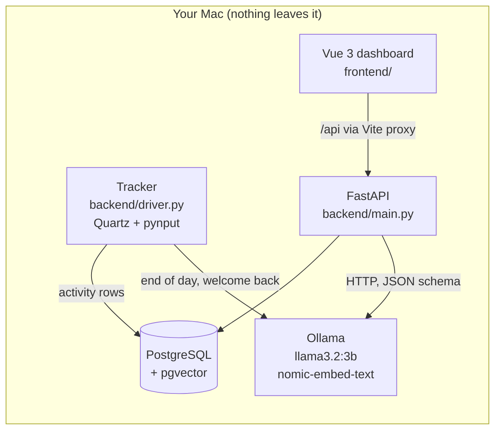

# AI Cognitive OS

A privacy-first personal assistant for macOS. It notices **how** you work (apps, window titles, focus, breaks),
never **what** you type, and turns that into useful help: habit predictions, a daily summary written by a
**local** language model, work grouped into tasks with embeddings, and answers to questions like
"What did I work on Tuesday?". Everything runs on your Mac; nothing is sent to a cloud service.


## Features

| Feature | How it works |
| --- | --- |
| Activity tracking | Every 2 s the active app and window title (macOS Quartz) plus keyboard/mouse **counts** (pynput) |
| Idle and presence | No input for 2 min = idle; calls and videos get 30 min, because you watch instead of type |
| Habit prediction | First-order Markov chain, P(next app B given app A), with an accept/ignore feedback loop |
| Day digest | Exact numbers per local day: minutes per app, top titles, breaks, switches, longest focus block |
| AI daily summary | Local LLM (Ollama, `llama3.2:3b`) writes headline, focus areas, insight and suggestion as JSON-schema output, validated with Pydantic; one retry on invalid JSON; rule-based fallback if the model is down; cached per day |
| Privacy guardrails | For private apps and incognito/banking windows the title is replaced by `(private)`; the app name and the time spent are still stored. Emails and long numbers are masked before any prompt |
| Categories | Work / learning / fun / communication / other: rules for clear apps, the LLM for browser titles, user corrections always win |
| Task grouping | Window titles embedded with `nomic-embed-text`, stored in **pgvector**, grouped by cosine similarity, named by the LLM |
| Ask your history (RAG) | Retrieves day digests by date and related titles by vector search, then the LLM answers only from that context |
| Smart timing | End-of-day summary waits for your next break (never after a set time); "welcome back" after a real absence |
| Dashboard | Vue 3 + TypeScript: daily summary, assistant messages, ask box, app chart, timeline, habits, privacy controls |

## Architecture



| Module | Role |
| --- | --- |
| `backend/driver.py` | Tracker loop: records windows, idle, habits, predictions, assistant timing |
| `backend/llm_client.py` | Ollama client: chat with JSON schema, embeddings, clear errors, timeouts |
| `backend/digest.py` | Day digest (pure arithmetic, local time zone) |
| `backend/summary.py` | AI daily summary: prompt, validation, retry, fallback, cache |
| `backend/privacy.py` | Guardrails before storage and before prompts |
| `backend/categories.py` | Title categories (rules, LLM batches, user corrections) |
| `backend/tasks.py` | Embeddings, pgvector similarity search, clustering into tasks |
| `backend/ask.py` | Ask your history (RAG) |
| `backend/timing.py`, `backend/assistant.py` | When to speak, and the assistant's messages |
| `backend/routes/` | API endpoints per feature |

## Privacy principles

1. **No content, no keystrokes:** only `+1` counts are stored; typed text, passwords and mouse positions are never captured.
2. **No screenshots:** only the app name and window title are read from the window manager.
3. **Local only:** data stays in your local PostgreSQL; the language models run locally with Ollama.
4. **Guardrails:** for private apps and private/banking windows the window title is stored as `(private)`; the app name and the time spent are still stored (the digest shows them only as "Private apps"). Emails and long numbers are masked before any prompt.
5. **Right to erasure:** pause anytime; "Clear history" deletes activities and everything learned from them (habits, summaries, categories, tasks).
6. **Other websites are blocked:** only the dashboard origin (`ALLOWED_ORIGINS` in `.env`) may call the API; any other website gets `403`.

## Setup (macOS)

```bash
# 1. Python environment
python3.12 -m venv venv
venv/bin/python -m pip install -r requirements.txt
cp .env.example .env            # then edit it with your database details

# 2. PostgreSQL with pgvector
brew install postgresql@17 pgvector
createdb cognitive_os           # the vector extension is enabled automatically on start

# 3. Local AI
brew install ollama
brew services start ollama
ollama pull llama3.2:3b
ollama pull nomic-embed-text

# 4. Dashboard
cd frontend && npm install
```

macOS permissions for the terminal or IDE that runs the tracker: **Screen Recording** (window titles) and
**Accessibility** (input counts) in System Settings, Privacy & Security. After recreating the venv, toggle
Accessibility off and on again.

## Run

```bash
venv/bin/python server.py                 # API on http://localhost:8000 (try it at /docs)
venv/bin/python -m backend.driver         # tracker
cd frontend && npm run dev                # dashboard on http://localhost:5173
venv/bin/python -m backend.llm_client "hello"   # quick check that the local model answers
```

With Docker (PostgreSQL + API in containers; Ollama and the tracker stay on the Mac): `docker compose up --build`.

## Tests

```bash
venv/bin/python -m pytest -q
```

The default tests use an in-memory SQLite database and a fake language model: no PostgreSQL, no Ollama, no
notifications. Integration tests for the real pgvector queries are marked `postgres` and skip unless a test database
is given (its name must end in `_test`; the real database is never used):

```bash
createdb cognitive_os_test
TEST_DATABASE_URL=postgresql+psycopg2://$USER@localhost/cognitive_os_test venv/bin/python -m pytest -m postgres
cd frontend && npm test                    # Vitest component tests
bash scripts/docker_smoke_test.sh          # build, start and check the Docker stack (API_PORT=8001 if 8000 is busy)
```

GitHub Actions runs 4 jobs on every push: backend tests, Postgres + pgvector integration tests (in a service
container; a skipped integration test fails the job), Docker build and smoke test, and frontend tests + build.

## Evaluation

`venv/bin/python -m scripts.evaluate --models llama3.2:3b qwen2.5:7b` measures category accuracy (on the tuning set
and on a held-out set), task-grouping precision/recall/F1 per similarity threshold, summary speed and grounding on
real days, and the cached-summary time.
Results: [docs/evaluation.md](docs/evaluation.md).

## Tech stack

Python 3.12 · FastAPI · Pydantic · SQLAlchemy · PostgreSQL 17 + pgvector · Ollama (Llama 3.2, nomic-embed-text) ·
httpx · NumPy · pytest · Vue 3 · TypeScript · Vite · Docker Compose · GitHub Actions
